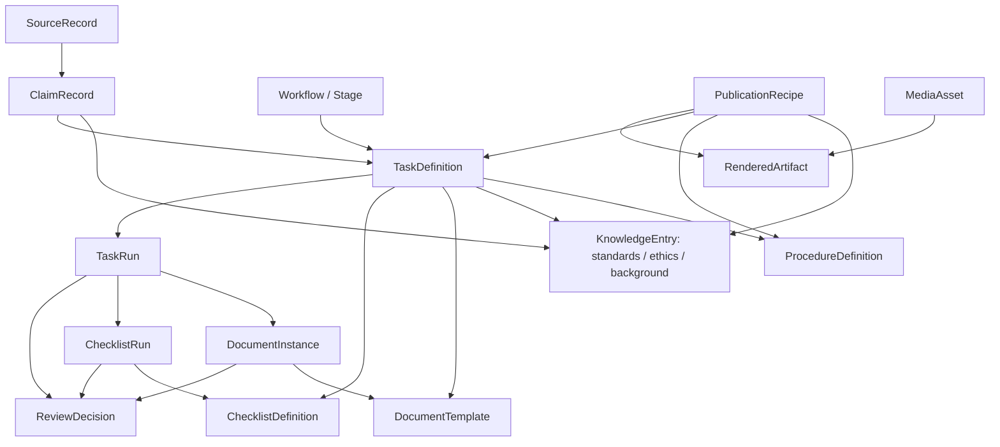

> Historical design note. Current implementation and source-of-truth rules are described in `GENERAL_PURPOSE_ARCHITECTURE_V9.md`. This document may describe earlier approaches.

# Object Relationship Map (v6)

**Conceptual edges**, not yet an execution engine. `ReviewDecision` and approval are independent of a completed checklist. Reused definitions are referenced by ID + pinned version.
